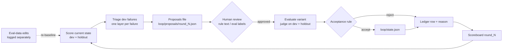

# How it works

A pre-review assistant for pharmaceutical promotion, plus the evals and the self-improvement loop that keep it honest.
It produces **flags, not approvals**. A human MLR (medical, legal, regulatory) reviewer makes every decision.

## 1. Inputs

- **Pieces** (`pieces/<slug>/`): the promotional item as text (`page.txt`), its safety section (`isi.txt`), screenshots, and `meta.json` (brand, established name, audience, capture time).
  The development field set was six public product homepages (consumer and HCP), unlabeled. Captures are third-party copyrighted, so only `pieces/manifest.json` (URLs and capture dates) ships. Re-capture them locally (see the README).
- **Product labeling** (`pieces/pi/`): prescribing information (PI) and medication guides as text. `pieces/pi_facts.json` (template: `pieces/pi_facts.example.json`) holds a short, hand-checked excerpt per product (indications, boxed warning, warnings and precautions, required risk terms) that the judge treats as authoritative.

## 2. Sources and rule families

- **FDA OPDP letters** (`letters/`): untitled and warning letters. Each cited claim becomes a positive eval case (`evals/opdp_cases.jsonl`) with the FDA rationale, category, regulation and check type.
- **Policy sources** (`rules/sources/`, archived text): five rule families:
  - **A**: statute and regulations (FD&C Act 502, 21 CFR 202.1, 314.81)
  - **B**: FDA guidance (social media, CFL, quantitative efficacy and risk, consumer broadcast, SIUU, and others)
  - **C**: FTC health-products substantiation and endorsements
  - **D**: OIG (speaker programs, CIA terms)
  - **E**: PhRMA DTC principles and Code

## 3. Rulebook and deterministic checks

Each rule (`rules/<family>.json`) has the following fields:
- `id`, `rule_text`
- `source` (document, section, URL, archived text file)
- `check_type`: `deterministic` or `judgment`
- `detection`: for deterministic rules, `check_fn`, `logic` and `inputs`; for judgment rules, `question`, `pass_anchor` and `fail_anchor`
- `opdp_case_ids` that exemplify the rule

Deterministic checks (`checks/margin_checks.py`) run first and are cheap. They cover established name, risk present and risk coverage, indication qualifiers, comparative and absolute language, post hoc and p-value language, 2253 submission metadata, and similar items. A check returns `pass`, `fail`, `needs_input` or `not_applicable` with evidence spans.

## 4. The judge

`judge/` holds an LLM judge behind any OpenAI-compatible endpoint (OpenRouter by default). It is model-agnostic, has temperature 0, caches every response by a hash of model, messages and parameters (reruns are free), retries with backoff, and enforces a hard budget cap.
- **Pairwise** (`judge/pairwise_prompt.md`): two versions of a claim, A and B, judged on one rule. The judge picks the one more compliant. Every pair is run in both orders to measure position bias.
- **Single-item** (`judge/single_prompt.md`): an absolute pass/fail on one rule, with an exact evidence span and a `missing_context` flag. This is the honest number: pairwise accuracy saturates easily, while single-item specificity does not.

## 5. Eval sets

| Set | File | Label | Purpose |
|---|---|---|---|
| Positives | `evals/opdp_cases.jsonl` | FDA-cited (real) | Recall of checks and judge |
| Controls | `evals/controls.jsonl` | Synthetic compliant rewrite of each cited claim | False-positive rate; negatives for the judge |
| Pairwise (easy) | `evals/pairwise.jsonl` (`kind=easy`) | Letter quote vs. rewrite | Judge calibration on known winners |
| Near-miss | `evals/near_miss_src*.py` | Synthetic, fictional products, minimal edits | Hard cases; coverage of rules with no letters |
| Holdout | `evals/holdout/` | Frozen letter-grouped split (~28%) | Tuning never looks at it; guards against overfitting |
| Field | `pieces/` | Unlabeled real pieces | Qualitative review; becomes labeled cases once a human reviews the flags |

The split is **letter-grouped** (all claims from one letter fall on the same side) and stratified by year, audience, majority check type and dominant rule family. The seed and IDs are in `evals/splits.json`.

## 6. Crosby mapping

| Crosby practice | Here |
|---|---|
| Deterministic checks first | `checks/` run before any LLM call; tracked as recall plus false-positive rate on controls |
| Blind, randomized pairwise review | A/B order randomized and swapped; position bias reported |
| Separate "approvable as is" flag | Single-item pass/fail with sensitivity and specificity reported separately |
| Calibrate the judge on known winners | Easy pairs (FDA-cited quote vs. fix) before near-miss and field |
| Separate synthesis failures from missing context | `missing_context` flag; `input_gap` layer in triage |
| Shared workbench | Ledger, scoreboard, triage and proposal files are plain JSON/Markdown that a reviewer can edit |

## 7. The loop and the acceptance rule

Run it with `python3 scripts/loop.py --round N`:
1. **Score**: build the items for the accepted state, judge them (cached), and compute the scoreboard (`evals/scoreboard/round_N_baseline.*`).
2. **Triage** (dev only): each failure gets exactly one root cause and one layer:
   - `rule_text`
   - `rule_assignment`
   - `eval_data`
   - `det_check`
   - `judge_prompt`
   - `judge_model`
   - `input_gap`

   Heuristics label first (one-order-only error → `judge_model`; placeholder in the compliant side → `eval_data`; missing visuals or study data → `input_gap`; deterministic misses and FPs → `det_check`). The LLM proposes the rest. Every row is written to `evals/triage/round_N.jsonl` with `review_status: unreviewed`.
3. **Propose**: changes are grouped by layer into `loop/proposals/round_N.json`. Judge-prompt addenda and rule-assignment changes may be auto-approved (`--auto-approve`). **Rule-text and eval-data proposals always need a human.**
4. **Evaluate**: each approved change becomes a *variant* (accepted state plus that change) and is scored on dev and holdout.
5. **Accept** only if all four hold:
   - (a) the change's target metric improves on dev;
   - (b) dev balanced accuracy does not drop beyond noise;
   - (c) holdout balanced accuracy and holdout pairwise accuracy do not drop beyond noise;
   - (d) no dev rule-family slice with ≥4 positives and ≥4 negatives drops beyond noise;
   - (e) neither dev single-item sensitivity nor dev specificity drops by more than 2× noise. Balanced accuracy alone can hide a trade of recall for specificity, and for a pre-review tool missed violations are the costly error. This criterion was added in round 2 after a "loosen" addendum raised balanced accuracy while cutting sensitivity about 10 points.

   Noise = max(1 item / n, √(p(1−p)/n)), plus a 0.0002 tolerance for 4-decimal rounding, so a drop of exactly one item is treated as noise. Accepted changes go into `loop/state.json`. Every decision is a row in `evals/ledger.jsonl` with before/after metrics for dev and holdout and the reason.
6. **Eval-data changes** (fixing a rewrite, adding pairs, removing placeholder leakage) edit the test, so they are **never accepted on metrics**. They are logged as `kind: eval_data` with a named reviewer, and the new score becomes the baseline (`--eval-data ID --reviewer NAME`). The goal is never to "improve" by editing the test.

Lessons from the first rounds on the shipped data, kept as defaults:
- Fix eval data first. Removing placeholder leakage moved the numbers more than any prompt change.
- Broad "be stricter" or "be looser" judge addenda mostly trade sensitivity for specificity, and criterion (e) rejects them.
- Matching each pair to the rule its letter category actually cites was the change that survived.

See `evals/scoreboard/SUMMARY.md` (before vs. after plus the ledger table, regenerated by `scripts/loop_summary.py`) and `evals/ledger.jsonl`.

Field pre-review: `python3 scripts/field_prereview.py` writes `pieces/prereview_<slug>.md`. Optional reviewer-facing notes in `pieces/prereview_notes.json` are re-inserted on every run.

The **scoreboard** reports, per split:
- judge single-item sensitivity, specificity and balanced accuracy (primary)
- easy vs. near-miss breakdown
- pairwise accuracy and position bias
- deterministic recall and false-positive rate on controls
- per-family and per-check-type slices
- rule coverage
- cost

## 8. Guardrails

- **Never approves.** Outputs are labeled "pre-review flags". A clean run means "no flags found", not "approved".
- **Never sends.** No email, posting or submission. All output is local files.
- **Flags only, with evidence.** Every flag cites a rule ID and quotes a span. Spans are verified against the source text, and unverified spans are marked.
- **Human decides.** Rule-text and label changes need a human. The holdout is never used for tuning.
- **Synthetic content is labeled** (`synthetic: true`, generator recorded).
- **Secrets:** API keys are read from a file at runtime and are never written to the repo, logs or caches.

## 9. Costs and known limits

- A full judge pass over the eval set (~200 pairs × 4 calls) costs about $0.15–0.30 with a small model. Cached reruns are free. The phase budget cap is in `config.yaml`, and spend is logged in `loop/spend.json`.
- **Limits:**
  - Controls and near-miss pairs are synthetic and not yet expert-reviewed.
  - Compliant rewrites are often longer than the originals, which is a residual cue.
  - The holdout was built after the authoring agent had seen all cases, so it protects only future tuning.
  - Text-only judging cannot assess visual prominence, placement or audio. These are flagged as `input_gap`.
  - Many deterministic checks need structured inputs (2253 records, timing, supers) that pieces lack.
  - Small family slices (C, D, E) are noisy.
  - The judge is a small model, and specificity on real pages is unproven until humans label the field flags.
